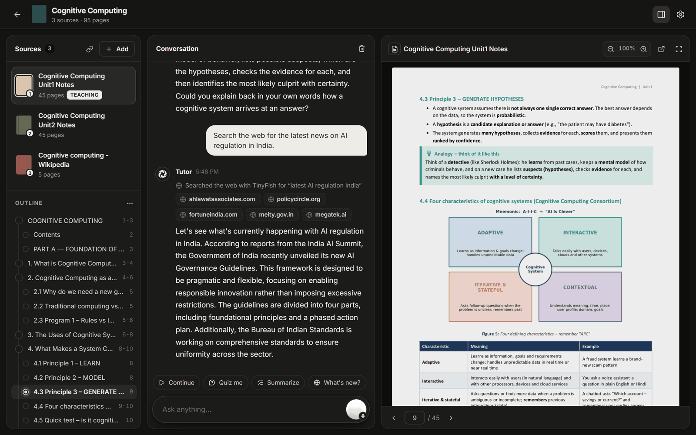
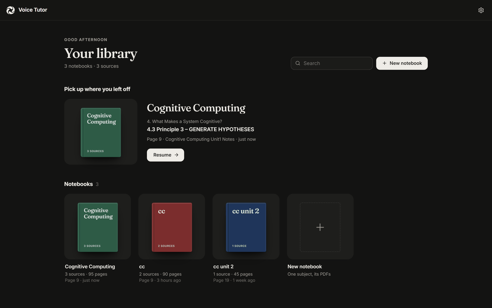
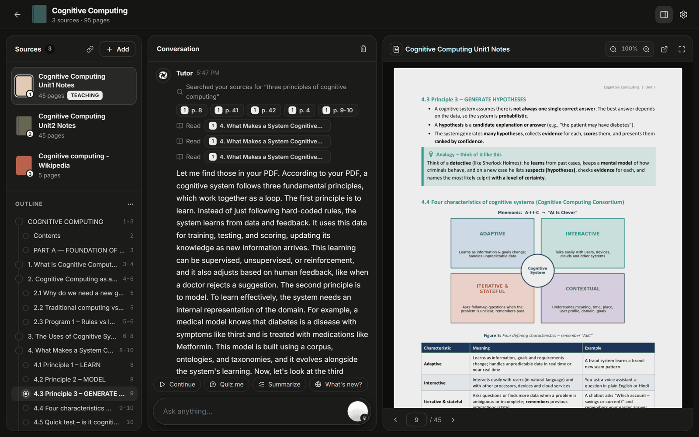
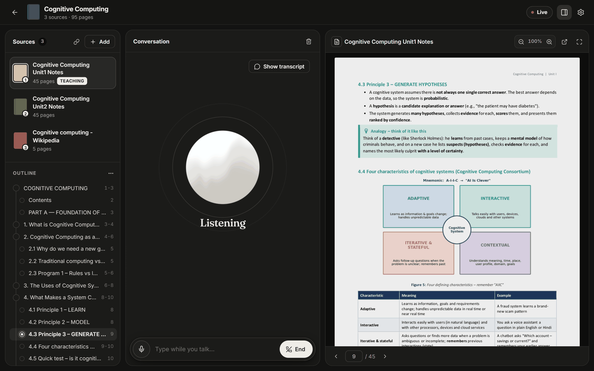
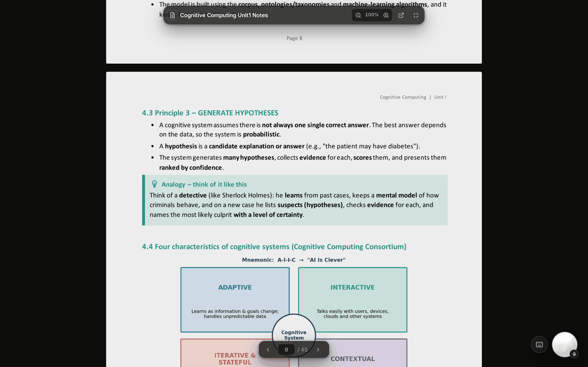
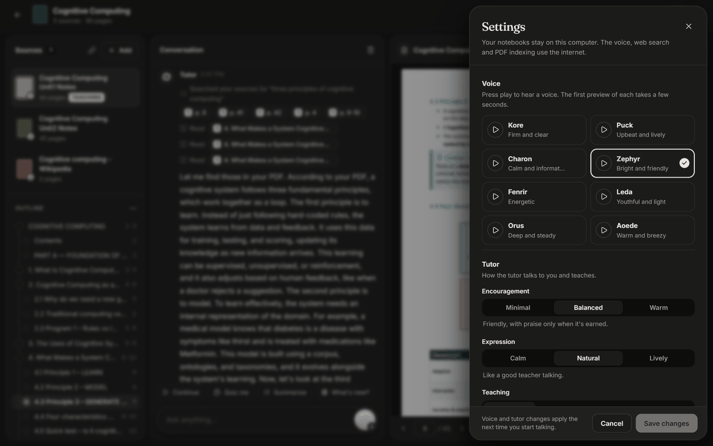
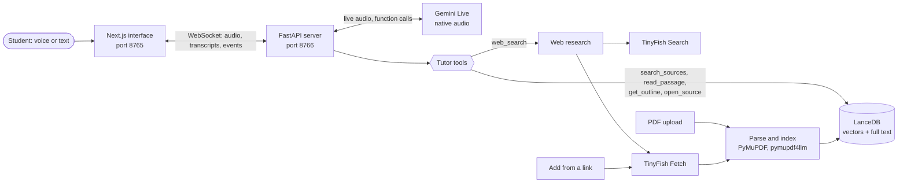

# Voice Tutor

**A live, one-to-one voice tutor for your own study material.** Add your PDFs or any web page, then talk. It teaches
the material part by part with page references, answers questions from your sources, checks the live web through
**TinyFish** when your notes fall short, and always tells you which answer came from where.




---

## Contents

1. [Why Voice Tutor](#why-voice-tutor)
2. [What it does](#what-it-does)
3. [Screenshots](#screenshots)
4. [How TinyFish is used](#how-tinyfish-is-used)
5. [Architecture](#architecture)
6. [How the tutor teaches](#how-the-tutor-teaches)
7. [Getting started](#getting-started)
8. [Configuration](#configuration)
9. [Testing and quality](#testing-and-quality)
10. [Project structure](#project-structure)
11. [Logs and troubleshooting](#logs-and-troubleshooting)
12. [Privacy and security](#privacy-and-security)
13. [Roadmap](#roadmap)

---

## Why Voice Tutor

Students learn from PDFs: lecture notes, textbook chapters, previous-year papers. Reading them is passive, doubts go
unanswered until the next class, and general chatbots answer from the internet at large rather than from the notes
the exam is based on. Tools like NotebookLM made "chat with your documents" common, but the conversation is still
typed, one question at a time.

Voice Tutor turns your study material into a teacher you can talk to:

- **It teaches, not just answers.** Ask it to start from the beginning and it explains each part of the PDF in order,
  with the page, then asks you to explain it back.
- **It stays grounded.** Every answer about the material comes from your sources and names the page. When the notes
  don't cover something, it says so before using general knowledge.
- **It reaches the live web when needed.** Current events, research papers, a definition your notes skip: TinyFish
  finds the pages and reads them, and the tutor names each source and compares it with your notes.
- **It works the way students talk.** Live voice you can interrupt, in English, Hindi or a mix, or typed when you
  can't speak aloud.

One partner, four roles:

| Role | What it does |
|---|---|
| **Tutor** | Teaches the material in order, one part at a time, remembers where you stopped, quizzes you |
| **Explainer** | Answers questions from your sources with page references |
| **Researcher** | Checks the live web with TinyFish and says which answer came from your notes and which from the web |
| **Brainstormer** | Builds on the material with you, and says when it goes beyond it |

---

## What it does

**Learning from your sources**
- Notebooks hold several sources each: PDFs, PDF links, and web pages. Search covers all of them; teaching follows
  the active one.
- Teaching in order: the tutor reads one part, explains every point in it, then moves to the next part, until the
  section is done. Each source remembers where you stopped, so "continue" picks up from there.
- Answers name the page ("page 8 says..."). Click a citation chip to jump to that page in the viewer.
- Navigation by voice: "go to chapter 3", "page 40", "the part about hypotheses", "go back", "switch to unit 2". The
  viewer follows when you ask to change the PDF or page.
- Quizzes, one question at a time, getting harder as you answer correctly, with a hint before the answer.

**Live research with TinyFish**
- Web search that reads pages, not snippets: general web, news with a time window, or research papers, with Indian
  sources preferred when the question is about India.
- **Add from a link**: paste any web page address and it becomes a source like a PDF, with an outline, page viewer,
  citations and teaching in order.

**Voice and interface**
- Live, interruptible voice conversation (Gemini Live), with captions and a typing bar that works alongside the voice.
- Eight voices with previews; tutor manner settings (how encouraging, how expressive, how it teaches).
- A PDF viewer with zoom, full-screen reading mode with a floating tutor orb, resizable panels, an outline with your
  current position, and a library that reopens each notebook at the page you stopped on.
- Works on phones: tabbed layout, touch controls, pinch to zoom, the screen stays on while studying.

---

## Screenshots

**Your library.** Each notebook is a book on the shelf; "Pick up where you left off" reopens the last one at the
section you were on.



**Teaching from the PDF.** The tutor searched the sources, read the three principles one at a time and explained
each with its page. The citation chips (p. 8, p. 9-10) open the page in the viewer.



**Live voice.** Tap the orb and talk; interrupt at any time. The transcript and the page stay one tap away.



**Full-screen reading.** The page fills the screen and the tutor becomes a floating orb you can tap to talk.



**Settings.** Voice previews, and how the tutor talks and teaches.



---

## How TinyFish is used

TinyFish is the project's connection to the live web. It does two jobs, and both are part of the core learning
flow, not add-ons.

| TinyFish API | Used for | Where in the code |
|---|---|---|
| **Search** (`GET api.search.tinyfish.ai`) | Finding pages for the tutor's web research: general web, news, research papers | `tutor/web.py` |
| **Fetch** (`POST api.fetch.tinyfish.ai`) | Reading the best search results as clean Markdown, so the tutor answers from page content | `tutor/web.py` |
| **Fetch** (HTML) | Turning any web page into a notebook source ("Add from a link") | `tutor/web_source.py` |

### 1. Web research: search, read, answer

When a question goes beyond your notes, or you ask it to search ("search the internet for...", "internet pe
dekho"), the voice model calls the app's `web_search` tool. Here is what happens next:

1. **The model writes a good query.** It sends English keywords (even if you spoke Hindi), your question in your
   own words, the kind of search (`general`, `news` or `research`), a time window for anything current, and
   whether the topic is about India.
2. **TinyFish Search finds candidates** with `language=en`, `location=IN` for Indian topics, `domain_type` set to
   news or research papers (with publication years for papers), a recency window, and a `purpose` that includes
   your question. `exclude_domains` drops social, login-walled and homework-dump sites (Quora, Pinterest, Reddit,
   Chegg, Course Hero, Scribd and others).
3. **Results are re-ranked.** There is a small boost for reliable sources (universities, `.gov`, `.ac.in`,
   `.nic.in`, Wikipedia, NCERT, NPTEL, Britannica and others), one result per site, duplicates dropped.
4. **TinyFish Fetch reads the best pages in parallel**, one request per page, so one slow site can't hold up the
   rest. Videos and sites that always block automated reading are listed as sources but not fetched; a page that
   comes back nearly empty is passed over for the next one. The whole search and read stays within about 9 seconds
   (typically 6 to 7, measured from India).
5. **Only the relevant text is kept.** From each page the paragraphs that best match the question are kept (rare
   words count more), with their nearest heading. Menus are dropped, and so is any text that tries to give the model
   instructions (a prompt-injection filter).
6. **The tutor answers from that text.** It names each source the way you would say it ("according to the Press
   Information Bureau", "The Hindu reports"), never reads out a web address, gives dates for anything current, and
   compares the result with your notes, which win for your course.

The conversation shows "Searched the web with TinyFish for ..." with a chip for every site used, and a repeated
question within 10 minutes is answered instantly from the last search.

**Example from a real session.** Asked "Search the web for the latest news on AI regulation in India", the tutor ran
a TinyFish news search targeted at India, read the top pages (sources included meity.gov.in and Fortune India), and
summarised the government's new AI Governance Guidelines and the Bureau of Indian Standards' work on AI standards.
The screenshot at the top of this page is that answer.

### 2. Add from a link: any web page becomes a source

Use the link button in Sources, or "Add from a link" on an empty notebook, and paste an address:

- **A web page** is read with TinyFish Fetch as clean HTML (menus, scripts and images dropped) and laid out as a
  PDF whose outline is the page's headings. From then on it is an ordinary source: outline, search, page viewer,
  page citations and teaching in order. Its first line names the original address. A Wikipedia article is indexed
  in about 10 seconds.
- **A link to a PDF file** is downloaded and added as it is.
- The server only downloads from public addresses (never this computer or a private network), checked again on
  every redirect.

### Reliability and switching

- `WEB_SEARCH` in `.env` picks the service: `tinyfish`, `tavily` or `duckduckgo`. The other services were kept, not
  removed, so the app works without a TinyFish key.
- If the chosen service fails (no internet, a daily limit), the next available one answers, in the order TinyFish,
  Tavily, DuckDuckGo, and the tutor is told which one did. Settings shows the active service.
- TinyFish errors are turned into plain sentences the tutor can say ("the web search isn't responding right now");
  error text is never read aloud.

---

## Architecture



| Part | Technology | Role |
|---|---|---|
| Voice | Gemini Live (`gemini-3.8-live`, native audio) | Speech in, reasoning and speech out in one live connection, with server-side turn detection and blocking function calls |
| Backend | Python, FastAPI, WebSockets | Notebooks, uploads, the voice session, the tutor's tools, guards that keep teaching on track |
| Retrieval | LanceDB, hybrid search | Vector search and full-text search fused with reciprocal rank fusion; chunks of about 550 tokens with overlap |
| Embeddings | EmbeddingGemma (offline) or Gemini Embedding 2 (online) | Chosen with `EMBEDDING_MODEL`; each source keeps an index per model and switches without re-reading the PDF |
| PDF parsing | PyMuPDF, pymupdf4llm | Text, headings, tables and outline; parsing runs in its own process so a bad file can't take the server down |
| Web | TinyFish Search and Fetch | Live web research and web pages as sources (see above) |
| Interface | Next.js 16, React 19, TypeScript | Library, notebook view, PDF viewer, voice orb, settings |

The tutor's tools are scoped to the open notebook: `get_outline`, `read_passage` (teach in order, jump to a section
or page), `open_source` (switch the PDF on screen), `search_sources` (find passages across all sources) and
`web_search`. Design decisions and measurements are recorded in [DESIGN.md](DESIGN.md).

---

## How the tutor teaches

The tutor's behaviour (`prompts/system.md`) was written from published research on AI tutoring and voice agents:
Google's LearnLM principles, a PNAS 2025 study showing that answer-giving AI tutors raise practice scores but lower
exam scores, retrieval practice, worked examples, misconception refutation and process praise. In practice:

- **Complete, then active.** It covers every point the source makes on a topic, then asks you to explain it back or
  apply it, instead of "Does that make sense?", which shows nothing about what was understood.
- **One part at a time.** It reads a part of the PDF, teaches it, then reads the next. A server-side guard enforces
  this: it holds back reading on until the current part has been explained, stops it skipping parts nobody asked
  to skip, and nudges it to carry on if it stops halfway through a section.
- **Hints before answers.** A wrong answer gets the first wrong step pointed out and a hint; the answer comes after a
  second try. It does not call a wrong answer right, and it does not give in when you insist on something your
  notes contradict.
- **Homework is guided, not written.** Facts and definitions from your notes are told with the page; work you will
  submit gets a hint ladder instead of a finished answer.
- **Sources first.** Course definitions in your notes win over the web and general knowledge, and anything from
  outside your sources is labelled as such.
- **Staying on track.** Small talk gets one line; learning questions outside your sources get brief, labelled help;
  unrelated tasks (booking tickets, writing emails) are declined politely; attempts to change its rules are refused.
- **Safety.** If a student mentions self-harm or danger, it stops tutoring and gives Tele-MANAS (14416) and the
  emergency number (112); personal medical, legal and financial decisions are referred to professionals; it never
  asks for or repeats personal details.
- **Your manner.** Settings control how encouraging it is (Minimal, Balanced, Warm), how expressive its voice is
  (Calm, Natural, Lively) and how it teaches (Direct, Step by step, Socratic, Exam prep). Encouragement changes the
  warmth, never the accuracy.

---

## Getting started

### Requirements

- Windows 10 or 11
- Python 3.10 or newer (3.13 recommended)
- Node.js 20.9 or newer (the LTS from nodejs.org)
- A free Gemini API key from [Google AI Studio](https://aistudio.google.com/apikey)
- Optional: a TinyFish API key from [agent.tinyfish.ai](https://agent.tinyfish.ai/api-keys) (Search and Fetch have
  a free daily allowance)
- Chrome or Edge for the microphone

### Run it

1. Double-click **`run.bat`**. It runs five steps in a setup window:
   1. **Virtual environment**: creates `.venv\` in this folder on the first run and checks it is valid.
   2. **Python dependencies**: installs everything into `.venv` (the first run downloads 1 to 2 GB and takes a few
      minutes; afterwards only when `requirements.lock` changes). Output: `logs\setup.log`.
   3. **Settings file**: creates `.env` from `.env.example` if missing and warns if the Gemini key is empty.
   4. **Interface**: installs and builds the Next.js app (about a minute the first time, then only when `frontend\`
      changes).
   5. **Servers**: opens two windows with live logs, "Voice Tutor - API" and "Voice Tutor - UI", then opens the app
      at http://127.0.0.1:8765. If they are already running, it just opens the browser.
2. Put your keys in `.env`:
   ```
   GEMINI_API_KEY=your-gemini-key
   WEB_SEARCH=tinyfish
   TINYFISH_API_KEY=your-tinyfish-key
   ```
   then close the two windows and run `run.bat` again.
3. Create a notebook, add PDFs (or a link), tap the orb and talk, or type.

To stop the app, close both windows. Drag a PDF onto `run.bat` to open it in a new notebook. Pages have real
addresses (`/` for the library, `/notebooks/<id>` for a notebook), so Back, Forward, bookmarks and new tabs work.

### Working with the code

From PowerShell in this folder:

```powershell
.\.venv\Scripts\Activate.ps1
python app.py                     # the API server (port 8766)
python ui.py serve                # the interface (port 8765), after: python ui.py build
python ui.py serve --dev          # the interface with hot reload while editing frontend\
python -m pytest -q               # the test suite
python ingest.py file.pdf         # index a PDF from the command line
python query.py "question"        # debug retrieval
python console.py                 # text console over one document
python manage.py data info        # what is stored; also: data prune, data backup <file>
```

To rebuild from scratch, delete `.venv` (and `frontend\node_modules`, `frontend\.next` for the interface) and run
`run.bat`. Ports can be changed in `.env` with `VOICE_TUTOR_PORT` (interface, default 8765) and
`VOICE_TUTOR_API_PORT` (API, default 8766).

---

## Configuration

All settings live in `.env`; `.env.example` lists every option with an explanation.

| Setting | Default | What it does |
|---|---|---|
| `GEMINI_API_KEY` | (required) | Voice conversation, and online embeddings |
| `WEB_SEARCH` | Tavily if its key is set, else DuckDuckGo | `tinyfish`, `tavily` or `duckduckgo` |
| `TINYFISH_API_KEY` | | Needed for `WEB_SEARCH=tinyfish` and for adding web pages as sources |
| `TINYFISH_FETCH_PAGES` | `3` | How many search results TinyFish Fetch reads (0 to 5; 0 means snippets only) |
| `TAVILY_API_KEY` | | Needed for `WEB_SEARCH=tavily` |
| `EMBEDDING_MODEL` | `offline` | `offline` (EmbeddingGemma on this computer) or `online` (Gemini Embedding 2) |
| `VOICE_TUTOR_LIVE_MODEL` | `gemini-3.8-live` | The Gemini Live model |
| `VOICE_TUTOR_VAD_SILENCE_MS` | `1000` | How long a pause ends your turn; raise it if the tutor cuts in while you think |
| `VOICE_TUTOR_VAD_END_SENSITIVITY` | `high` | How readily the tutor decides you have finished (high: answers promptly even with faint room noise) |
| `VOICE_TUTOR_VAD_START_SENSITIVITY` | `low` | How readily sound counts as you starting to talk (low: the tutor's own voice from a speaker does not interrupt it) |
| `VOICE_TUTOR_VAD_PREFIX_MS` | `300` | How long a sound must last before it counts as speech |

### Offline or online embeddings

| `EMBEDDING_MODEL=` | Model | Use it when |
|---|---|---|
| `offline` | EmbeddingGemma, on this computer | The computer can run it (downloads about 1.5 GB once; search then works without internet) |
| `online` | Gemini Embedding 2, with your `GEMINI_API_KEY` | The computer cannot run the local model (older or low-memory machines); nothing large is downloaded |

Restart the app after changing it. Each source keeps a separate index per model; sources indexed with the other
model are updated automatically in the background from the text already stored, without re-reading the PDF and
without losing your reading position. Until a source is updated, searching it still works by keywords. On the free
tier, online indexing runs at about 100 chunks a minute (a 50-page PDF takes about 2 minutes).

---

## Testing and quality

- **249 automated tests** (`python -m pytest -q`) cover retrieval, PDF parsing, the tutor's tools, the voice session
  logic, the teaching guards, web search with TinyFish (parameters per search kind, re-ranking, parallel reading,
  deadlines, fallbacks, the injection filter), adding web sources (including the private-address checks), the
  server API and configuration errors.
- **Live conversation tests.** Twenty scripted conversations run against the real Gemini Live model through the
  local server: teaching a section, off-topic requests, jailbreak attempts, homework, pushback on a wrong claim,
  questions outside the notes, news and research-paper searches, Hindi, a crisis message, quizzes, unclear audio,
  abuse, medical and personal-data requests, and switching PDFs by voice.
- **Measured, not guessed.** Turn-taking settings were chosen from recorded-speech experiments (reply delay with
  room noise, and whether mid-sentence pauses get cut off); web search time budgets come from measured TinyFish
  response times from India. The numbers are in [DESIGN.md](DESIGN.md).
- **Diagnosable.** The server logs each reply's delay with the microphone's room level, every tool call with its
  timing, and a warning when a turn gets no answer, so a problem in the field can be traced from the log.

---

## Project structure

```
app.py                 API server entry point
ui.py                  interface server (build, serve, open the browser)
run.bat                one-click setup and start on Windows
prompts/system.md      the tutor's instructions
tutor/
  server/              FastAPI app, voice session (live.py), background jobs
  voice/               Gemini Live session, system prompt builder, tutor manner styles
  retrieval/           LanceDB store and hybrid search
  tools.py             the tools the voice model can call
  web.py               web research: TinyFish Search and Fetch, Tavily, DuckDuckGo
  web_source.py        web pages and PDF links as sources (TinyFish Fetch)
  lesson.py            teaching order, sections and reading position
  library.py           documents, indexes and the document cache
frontend/              Next.js interface (src/app pages, src/components, src/lib)
tests/                 the test suite
deploy/                optional hosting (Vercel and a VPS); currently switched off
DESIGN.md              design decisions, research and measurements
```

| What | Where |
|---|---|
| Code, `.env`, `logs\` | this folder |
| Python virtual environment | `.venv\` (created by `run.bat`) |
| Interface packages and build | `frontend\node_modules\`, `frontend\.next\` |
| Your notebooks, indexes and uploaded PDFs | `%LOCALAPPDATA%\voice-tutor` |

If this folder is inside OneDrive, OneDrive also syncs `.venv` (about 2 GB), which makes the first install slow; if an
install fails with "Access is denied", pause OneDrive syncing and run `run.bat` again, or move the project to a
folder such as `C:\dev\voice-tutor`.

---

## Logs and troubleshooting

| File | Contents |
|---|---|
| `logs\voice-tutor.log` | Everything the API server does: requests, uploads and indexing stages, voice sessions (connect time, tool calls with timings, reply delay, each exchange), errors with tracebacks |
| `logs\errors.log` | Warnings and errors only; check this first |
| `logs\ui.log` | The interface server output |
| `logs\embedder-crash.log` | The embedding model's process: the computer's details at each start and any crash |
| `logs\crash.log` | A stack trace if the API server ever crashes outside Python |
| `logs\setup.log` | `run.bat` steps, pip and npm output, interface builds |

- If indexing a PDF fails, the source shows the reason (for example an older processor or too little free memory)
  and the app keeps running. If the local embedding model cannot run on the computer, set `EMBEDDING_MODEL=online`.
- The embedding model runs in its own process; if it crashes, the app restarts it in a slower safe mode and carries on.
- Run `python app.py --debug` to see every event in the API window too.

---

## Privacy and security

- PDF parsing, indexing and search run on your computer, and your notebooks stay in `%LOCALAPPDATA%\voice-tutor`.
- The voice model is Gemini Live: what you say and the passages it reads are sent to Google (on the free tier,
  Google may use them to improve its products). With `EMBEDDING_MODEL=online`, the text of your PDFs is also sent to
  Google for indexing.
- Web searches go to the service chosen with `WEB_SEARCH` (the question, and with TinyFish the addresses of the pages
  it reads); "Add from a link" sends the address to TinyFish when it is a web page.
- Text from web pages is treated as material, never as instructions: instruction-like paragraphs are filtered out
  before the model sees them, and the tutor is told not to follow anything a source tells it to do.
- Links are only fetched from public addresses, checked again on every redirect.
- Even locally, the API refuses requests that change anything when they come from another website, and the pages
  carry a strict Content Security Policy. API keys stay in `.env`, which is never committed.

The same code can also run as a hosted website with a login (an interface on Vercel and the API on your own server);
that setup is described in [deploy/README.md](deploy/README.md) and is currently switched off.

---

## Roadmap

- **Mobile app** with offline reading and push reminders for revision.
- **TinyFish Agent** for multi-step research: following a topic across several sites, or gathering a syllabus's
  reading list into a notebook in one request.
- **Spaced repetition**: quizzes scheduled from what the student got wrong, and flashcards generated from the sources.
- **More Indian languages** for explanations, with technical terms kept in English.
- **Institution plans**: shared notebooks for a class, so a teacher's notes become every student's tutor.

---

Built for **Kritical Hacks 2026** (AI/ML track), with TinyFish as the live-web layer. Design notes, research and
measurements: [DESIGN.md](DESIGN.md).
